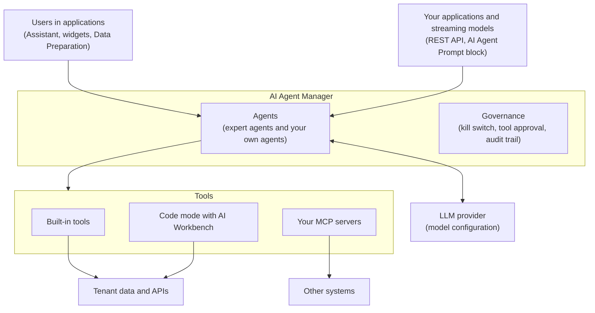


The AI Agent Manager, the Assistant, and the features that build on them are currently in Public Preview and might change or are not feature complete. While we try to keep changes as low as possible, breaking changes and feature removals happen. To enable the AI Agent Manager and the Assistant, open the right drawer (by clicking on your username initials) in the Administration application and select **Manage preview features**. Then activate the toggle next to **AI Agent Manager**.


 provides AI agents that work with the data of your tenant. You use the agents that come with the platform, such as the Assistant, and you build your own agents with the AI Agent Manager. All agents work the same way:

- They use the LLM provider and the model that your administrator configures.
- Their built-in tools access the data of your tenant with the permissions of the user who runs the agent.
- Administrators turn them on or off, control which tools need approval, and review every run in one place.

### How the parts fit together {#how-the-parts-fit-together}

The AI capabilities consist of four parts:

- **Expert agents**: Agents for specific tasks that the  applications provide, such as the Assistant in the application header and the AI assistant in Data Preparation. For details, see [Expert agents](/ai-intro/expert-agents/).
- **Agent enablement**: The AI Agent Manager, where you create your own agents and give them tools, the MCP servers that connect agents to other systems, code mode with AI Workbench, the AI Agent Prompt block for streaming models, and the REST API. For details, see [Agent enablement](/ai-intro/agent-enablement/).
- **Data and context**: The data that agents work with. Agents read and change the inventory, measurements, alarms, events, and operations of your tenant. In code mode, they also use the APIs of the microservices in your tenant, such as the Digital Twin Manager. Agents look up the  documentation, and the Assistant also knows which device, group, or dashboard you are looking at.
- **Governance and safety**: The model configuration, the permissions, the tool approval, the kill switch, and the audit trail of all agent runs. For details, see [Governance and safety](/ai-intro/ai-governance/).

The following diagram shows how a request flows through these parts:

1. A user asks a question in an application, or an application or a streaming model calls an agent.
2. The AI Agent Manager runs the agent. It sends the system prompt, the conversation, and the descriptions of the tools of the agent to the LLM provider.
3. The model answers or requests a tool call. If the tool requires approval, the user approves or denies the call first.
4. The AI Agent Manager runs the tool and returns the result to the model, until the model produces the final answer.
5. The AI Agent Manager records the run and its tool calls in the audit trail.

### Capabilities summary {#capabilities-summary}

| Capability | What it does | Status | Documentation |
|------------|--------------|--------|---------------|
| Assistant | A context-aware AI chat in the application header that answers questions and changes data | Public Preview | [Assistant](/assistant/assistant-introduction/) |
| AI assistant in Data Preparation | Creates the smart functions that transform incoming device messages | Public Preview | [AI assistant](/data-preparation/rule-editor/#ai-assistant) |
| AI generation in widgets | Creates the code of HTML widgets and the SVG of SCADA widgets | Requires the AI Agent Manager (Public Preview) | [Expert agents](/ai-intro/expert-agents/#ai-in-widgets) |
| AI Agent Chat widget | Adds a chat with an agent of your choice to a dashboard | Public Preview | [Expert agents](/ai-intro/expert-agents/#ai-agent-chat-widget) |
| AI Agent Manager | Creates, tests, and manages agents | Public Preview | [AI Agent Manager](/ai/aim-introduction/) |
| Tools and MCP servers | Give agents access to  data and to other systems | Public Preview | [Tools and MCP](/ai/tools-mcp/) |
| Code mode with AI Workbench | Lets agents write and run code against the APIs of your tenant | Public Preview | [AI Workbench and code mode](/ai/ai-workbench/) |
| AI Agent Prompt block | Calls an agent from an Analytics Builder model | Public Preview | [AI Agent Prompt](/streaming-analytics/block-reference/#ai-agent-prompt) |
| REST API | Calls agents from your own applications and manages agents programmatically | Public Preview | [REST API](/ai/rest-api/) |
| Model configuration | Sets the LLM provider and model for all agents or for single agents | Public Preview | [Model configuration](/ai/control-panel/#model-configuration) |
| Tool approval | Asks a user to approve a tool call before it runs | Public Preview | [Governance and safety](/ai-intro/ai-governance/#tool-approval) |
| Kill switch | Turns off all AI agents of the tenant at once | Public Preview | [AI agent availability](/ai/control-panel/#ai-agent-availability) |
| Observability | Records every agent run and its tool calls, and exports traces to your own collector | Public Preview | [Observability](/ai/observability/) |

### Prerequisites {#prerequisites}

Before you use the AI capabilities, make sure that your tenant and your user meet the following requirements:

- The microservice `ai` (AI Agent Manager) is available in your tenant. The Assistant and code mode also require the microservice `ai-workbench` (AI Workbench). Check this in the Administration application under **Ecosystem** > **Microservices**.
- Your user has READ or ADMIN permission for the permission type "AI agent". The control panel requires ADMIN permission.
- An administrator has configured a model in the control panel. For details, see [Getting started by configuring a model](/ai/aim-introduction/#getting-started-by-configuring-a-global-provider).
- AI agents are turned on in the control panel. For details, see [AI agent availability](/ai/control-panel/#ai-agent-availability).

Some features have additional requirements. For example, Data Preparation has its own preview feature. The pages of each feature list them.


Without a model configuration, the  platform never connects to any external LLM provider. For details on which data the platform sends to the LLM provider and how the providers handle it, see [AI aspects](/concepts/concepts-ai/).



- [Expert agents](/ai-intro/expert-agents/) for the agents that the  applications provide.
- [Agent enablement](/ai-intro/agent-enablement/) for building your own agents.
- [Governance and safety](/ai-intro/ai-governance/) for controlling and monitoring AI in your tenant.
- [AI aspects](/concepts/concepts-ai/) for data protection and frequently asked questions.

