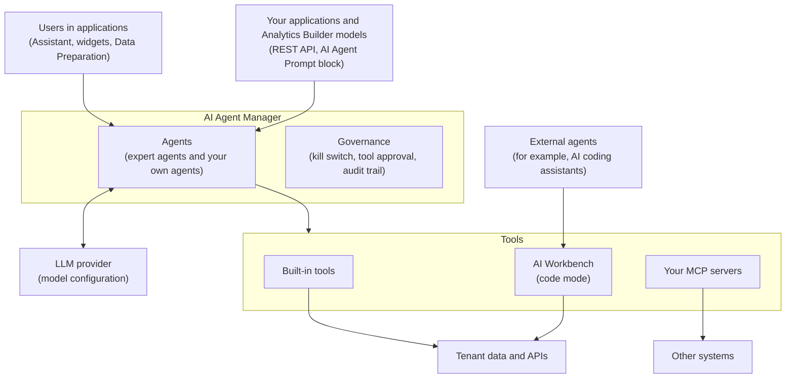


The AI Agent Manager, the Assistant, and the features that build on them are currently in Public Preview and functionality might still change. To enable the preview for the AI Agent Manager and the Assistant, open the right drawer (by clicking on your username initials) in the Administration application and select **Manage preview features**. Then activate the toggle next to **AI Agent Manager**.


 provides agentic AI capabilities for industrial operations. AI agents work with the context of your connected assets, such as devices, groups, measurements, alarms, and events.

You can use agents that come with  applications, customize them, build your own agents, and connect agents from outside of . All of these use the same foundations:

- They use the LLM provider and the model that your administrator configures.
- Their tools access the data of your tenant with the permissions of the user or service who runs the agent.
- Administrators control which tools need approval, can turn off all agents at once, and review the runs of the agents in one place.

### How the parts fit together {#how-the-parts-fit-together}

The agentic AI capabilities consist of four parts:

- **Expert agents**: Predefined agentic workflows that come with the  applications to perform specific tasks, such as the Assistant in the application header and the Assistant in Data Preparation. For details, see [Expert agents](/ai-intro/expert-agents/).
- **Agent enablement**: Functionality to build your own agents in the AI Agent Manager, to customize the agents that applications provide, and to give agents access to your tenant and to other systems through tools, MCP servers, and AI Workbench with code mode. External agents can connect to the AI Workbench and MCP tools as well. You can use your agents in your applications, in Analytics Builder models, and through the REST API. For details, see [Agent enablement](/ai-intro/agent-enablement/).
- **Data and context**: The data that agents work with. You can choose which data you want to allow agents to only read and which changes they are allowed to make with or without human approval. Agents can also look up the  documentation, and the Assistant is aware of which device, group, or dashboard you are looking at. For details, see [Data and context](/ai-intro/data-and-context/).
- **Governance and safety**: You can set controls that define what an agent can change: the model configuration, the permissions, the tool approval, the kill switch, and the audit trail of all agent runs. For details, see [Governance and safety](/ai-intro/ai-governance/).

The following diagram shows how a request flows through these parts:

1. A user asks a question in an application, or an application or an Analytics Builder model calls an agent.
2. The AI Agent Manager runs the agent. It sends the system prompt, the conversation, and the descriptions of the tools of the agent to the LLM provider.
3. The model answers or requests a tool call. If the tool requires approval, the user approves or denies the call first.
4. The AI Agent Manager runs the tool and returns the result to the model, until the model produces the final answer.
5. The AI Agent Manager records the run and its tool calls in the audit trail.

Note that external agents use their own LLM and connect to the AI Workbench directly. Their API calls run with the permissions of the user who connects. The model configuration of the AI Agent Manager and the kill switch do not apply to them. For details, see [AI Workbench and code mode](/ai/ai-workbench/).

### Capabilities summary {#capabilities-summary}

| Part | Capability | What it does | Status | Documentation |
|------|------------|--------------|--------|---------------|
| Expert agents | Assistant | A context-aware AI chat in the application header that answers questions and changes data | Public Preview | [Assistant](/assistant/assistant-introduction/) |
| Expert agents | Assistant in Data Preparation | Creates the smart functions that transform incoming device messages. AI is used only at design time | Public Preview | [AI assistant](/data-preparation/rule-editor/#ai-assistant) |
| Expert agents | AI generation in widgets | Creates the code of HTML widgets and the SVG of SCADA widgets | Requires the AI Agent Manager (Public Preview) | [Expert agents](/ai-intro/expert-agents/#ai-in-widgets) |
| Agent enablement | AI Agent Manager | Creates, tests, and manages agents, and customizes the agents that applications provide | Public Preview | [AI Agent Manager](/ai/aim-introduction/) |
| Agent enablement | Tools and MCP servers | Give agents access to  data and to other systems | Public Preview | [Tools and MCP](/ai/tools-mcp/) |
| Agent enablement | AI Agent Prompt block | Calls an agent from an Analytics Builder model | Public Preview | [AI Agent Prompt](/streaming-analytics/block-reference/#ai-agent-prompt) |
| Agent enablement | REST API | Calls agents from your own applications and manages agents programmatically | Public Preview | OpenAPI specification in your tenant at `/service/ai/api-json` |
| Data and context | AI Workbench | Lets agents use code mode to write and run code against the APIs of your tenant. External agents can connect to it as well | Public Preview | [AI Workbench and code mode](/ai/ai-workbench/) |
| Governance and safety | Model configuration | Sets the LLM provider and model for all agents or for single agents | Public Preview | [Model configuration](/ai/control-panel/#model-configuration) |
| Governance and safety | Tool approval | Asks a user to approve a tool call before it runs | Public Preview | [Governance and safety](/ai-intro/ai-governance/#tool-approval) |
| Governance and safety | Kill switch | Turns off all AI agents of the tenant at once | Public Preview | [AI agent availability](/ai/control-panel/#ai-agent-availability) |
| Governance and safety | Observability | Records every agent run and its tool calls, and exports traces to your own collector | Public Preview | [Observability](/ai/observability/) |

### Prerequisites {#prerequisites}

Before you use the agentic AI capabilities, make sure that your tenant and your user meet the following requirements:

- The microservice `ai` (AI Agent Manager) is available in your tenant. The Assistant and code mode also require the microservice `ai-workbench` (AI Workbench). Check this in the Administration application under **Ecosystem** > **Microservices**.
- Your user has READ or ADMIN permission for the permission type "AI agent". The control panel requires ADMIN permission.
- An administrator has configured a model in the control panel. For details, see [Getting started by configuring a model](/ai/aim-introduction/#getting-started-by-configuring-a-global-provider).
- AI agents are turned on in the control panel. For details, see [AI agent availability](/ai/control-panel/#ai-agent-availability).

Some features have additional requirements. For example, Data Preparation has its own preview feature. The pages of each feature list them.


Without a model configuration, the  platform never connects to any external LLM provider. For details on which data the platform sends to the LLM provider and how the providers handle it, see [AI aspects](/concepts/concepts-ai/).



- [Expert agents](/ai-intro/expert-agents/) for the agents that the  applications provide.
- [Agent enablement](/ai-intro/agent-enablement/) for building, customizing, and connecting agents.
- [Data and context](/ai-intro/data-and-context/) for the data and the context that agents work with.
- [Governance and safety](/ai-intro/ai-governance/) for controlling and monitoring AI in your tenant.
- [AI aspects](/concepts/concepts-ai/) for data protection and frequently asked questions.

